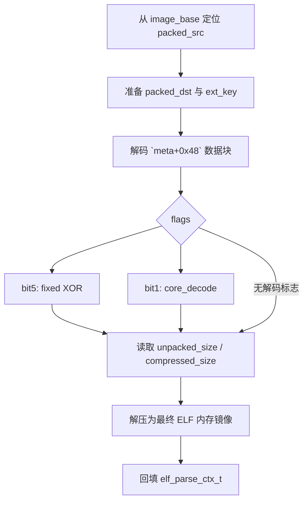

# 解压专家 （apk）

# 前言

时间不是很充裕，有一些细节没有完善，有兴趣的可以深入分析、比如后续 GOT 链接这些的...本人也是刚学

分析一款可以共享密码的解压缩 app，其中用到了 native 的知识点

本文将介绍两种 native 解密方法

# java 层


```java
public static void checkPasswordFromServer(String s, Context context0, FindPasswordCallback zipUtil$FindPasswordCallback0) {
    new Thread(new Runnable() {
        @Override
        public void run() {
            var hashMap0 = new HashMap();
            DocumentFileBean documentFileBean0 = DocumentFileManager.getFileBean(context0, s);
            if(documentFileBean0 != null) {
                String s = documentFileBean0.getFileName();
                long v = documentFileBean0.getFileSize();
                hashMap0.put("fileName", s);
                hashMap0.put("fileSize", v);
                String s1 = ZMCoreUnZipWrapper.getQPWAT(context0, s + v);
                try {
                    hashMap0.put("md5", FileUtil.getFileMd5(s));
                }
                catch(Exception exception0) {
                    exception0.printStackTrace();
                }

                var gson0 = new Gson();
                String s2 = gson0.toJson(hashMap0);
                var okHttpClient0 = new OkHttpClient();
                try {
                    var secureRandom0 = new SecureRandom();
                    byte[] arr_b = new byte[16];
                    secureRandom0.nextBytes(arr_b);
                    var ivParameterSpec0 = new IvParameterSpec(arr_b);
                    var secretKeySpec0 = new SecretKeySpec("EyR2JvBXJXaUdY9auxetvhpEeQ8DmC6L".getBytes("UTF-8"), "AES");
                    String s3 = gson0.toJson(new ZipCheckInfo(Base64.encodeToString(ZipUtil.GeneralEncrypt(s2.getBytes("UTF-8"), secretKeySpec0, ivParameterSpec0), 2), Base64.encodeToString(arr_b, 2)));
                    RequestBody requestBody0 = RequestBody.create(ZipUtil.JSON, s3);
                    okHttpClient0.newCall(new Builder().url("https://file.unisapps.com/api/v3/search/info").addHeader("User-Client-Access", s1).addHeader("appid", "zipa").addHeader("version", CommonUtil.getVersionName(context0)).addHeader("platform", "android").post(requestBody0).build()).enqueue(new Callback() {
                        @Override  // okhttp3.Callback
                        public void onFailure(Call call0, IOException iOException0) {
                            Log.d("onFailure", "onFailure---" + iOException0.getMessage());
                            com.fileunzip.zxwknight.utils.ZipUtil.8.this.val$callback.findPassword("");
                        }

                        @Override  // okhttp3.Callback
                        public void onResponse(Call call0, Response response0) throws IOException {
                            if(response0.isSuccessful()) {
                                if(response0.code() != 200) {
                                    com.fileunzip.zxwknight.utils.ZipUtil.8.this.val$callback.findPassword("");
                                    return;
                                }

                                try {
                                    String s = response0.body().string();
                                    Class class0 = new HashMap().getClass();
                                    var map0 = (Map)gson0.fromJson(s, class0);
                                    byte[] arr_b = Base64.decode(((String)map0.get("data")), 2);
                                    var ivParameterSpec0 = new IvParameterSpec(Base64.decode(((String)map0.get("iv")), 2));
                                    var s1 = new String(ZipUtil.GeneralDecrypt(arr_b, secretKeySpec0, ivParameterSpec0), "UTF-8");
                                    new HashMap();
                                    Class class1 = map0.getClass();
                                    var s2 = (String)((Map)gson0.fromJson(s1, class1)).get("pd");
                                    com.fileunzip.zxwknight.utils.ZipUtil.8.this.val$callback.findPassword(s2);
                                }
                                catch(Exception unused_ex) {
                                    com.fileunzip.zxwknight.utils.ZipUtil.8.this.val$callback.findPassword("");
                                }

                                Log.d("map", "map");
                                return;
                            }

                            com.fileunzip.zxwknight.utils.ZipUtil.8.this.val$callback.findPassword("");
                        }
                    });
                }
                catch(Exception exception1) {
                    exception1.printStackTrace();
                }

                return;
            }

            zipUtil$FindPasswordCallback0.findPassword("");
        }
    }).start();
}
```

---

#### getVersionName

```java
public static String getVersionName(Context context0) {
    try {
        return context0.getApplicationContext().getPackageManager().getPackageInfo("com.fileunzip.zxwknight", 0).versionName;
    }
    catch(PackageManager.NameNotFoundException packageManager$NameNotFoundException0) {
        packageManager$NameNotFoundException0.printStackTrace();
        return "";
    }
}
```


#### User-Client-Access

```java
String s = documentFileBean0.getFileName();
long v = documentFileBean0.getFileSize();
hashMap0.put("fileName", s);
hashMap0.put("fileSize", v);
String s1 = ZMCoreUnZipWrapper.getQPWAT(context0, s + v);
```

其中 `getQPWAT` 调用 libZMCoreUnZip.so 的 `executeGBS` native 方法

```java
public static String getQPWAT(Context context0, String s) {
    return ZMCoreUnZipZipApi.executeGBS(s, context0);
}

public class ZMCoreUnZipZipApi {
    static {
        System.loadLibrary("ZMCoreUnZip");
    }

    public static native int executeConfig(String arg0, ZMCoreUnZipZipExtractCallback arg1, String arg2, Context arg3, int arg4) {
    }

    public static native String executeGBS(String arg0, Context arg1) {
    }

    public static native String getVersionInfo() {
    }
}
```

# native 层

## 静态分析+vibe

发现能识别 elf，但是 export 符号很奇怪，不是可见字符，且指示条不正常


发现 JNI_OnLoad export 不存在，所以看 init_array


发现不是很好找，这里根据 elf 结构我们可以直接根据 `Elf64_Dyn` 类型引用定位到 *ELF Dynamic Information* 然后找到 `DT_INIT_ARRAY`


随后发现 init_array 均为空值 0，说明需要重定向。

查看 `DT_RELA` 元素为 `Elf64_Rela`

```c
struct Elf64_Rela
{
  unsigned __int64 r_offset;
  unsigned __int64 r_info;
  __int64 r_addend;
};
```

注意我们需要 `r_info == 0x403` 的项目，且 `r_offset` 需要位于 `[DT_INIT_ARRAY, DT_INIT_ARRAY + DT_INIT_ARRAYSZ)` 之中，即 `[0x55DB00, 0x55DB00+0x20)`


所以 init_array 为

```c
0x549504 // init1
0x5495B4 // init2
0x549D08 // init3
0
```

可以通过编写以下脚本来应用重定向

```python
# from `ELF RELA Relocation Table`
base = 0
table = [
    (0x55DB00, 0x549504),
    (0x55DB08, 0x5495B4),
    (0x55DB10, 0x549D08),
    (0x55DB20, 0x549490),
    (0x55DB28, 0x54949C),
    (0x55DE30, 0x55F5B0),
    (0x55DE68, 0x55F5A8),
    (0x55DE70, 0x55E008),
    (0x55DEA0, 0x553A88),
    (0x55DEB0, 0x557268),
    (0x55DEC0, 0x55F550),
    (0x55DED0, 0x54B288),
    (0x55DEE0, 0x55F5C0),
    (0x55DF10, 0x55E130),
    (0x55DF60, 0x55723C),
    (0x55DF78, 0x55FA30),
    (0x55DF90, 0x55FB88),
    (0x55DFB0, 0x55FB50),
    (0x55DFC0, 0x54AFE0),
    (0x55DFD0, 0x55F5B8),
    (0x55DFD8, 0x54B070),
    (0x55DFE0, 0x55F9E0),
    (0x55F5B0, 0x63BF68),
    (0x55F5B8, 0),
]

def main():
    import utils_ida
    for old, new in table:
        print(f"patch {hex(old)} -> {hex(base + new)}")
        utils_ida.DelItem(old, 8)
        utils_ida.CreateQword(old)
        utils_ida.Patch(old, (base + new).to_bytes(8, 'little'))
        utils_ida.SetType(old, "void (*)(void)")

if __name__ == "__main__":
    main()
```

---

借助 ai 分析，能够找到关键全局变量并创建结构体

```c
#pragma pack(push, 2)
struct loader_meta_t
{
  unsigned __int64 image_header_off;
  unsigned __int64 program_headers_off;
  unsigned __int64 dynsym_off;
  unsigned __int64 dynstr_off;
  unsigned __int64 unknown_table_20_off;
  unsigned __int64 rela_off;
  unsigned __int64 jmprel_off;
  unsigned __int64 optional_table_off;
  unsigned __int64 dynamic_off;
  unsigned __int64 aux_src_off;
  unsigned __int64 callback_or_code_off;
  unsigned __int64 loader_entry_off;
  unsigned __int64 android_reloc_off;
  unsigned int phnum;
  unsigned int unknown_6C;
  unsigned int rela_count;
  unsigned int jmprel_count;
  unsigned int android_reloc_size;
  unsigned int payload_seed0;
  unsigned int flags;
  unsigned int packed_size;
  unsigned int aux_size;
  unsigned int init_stage;
  unsigned int dynsym_seed0;
  unsigned int sym_index_begin;
  unsigned int sym_index_end;
  unsigned int dynsym_seed3;
  unsigned int resource_flags;
  unsigned int loader_word_A4;
  int gate_beg;
  int gate_end;
  unsigned int split_begin;
  unsigned int split_end;
};
#pragma pack(pop)
```

```c
.data:000000000063BF68 ; loader_meta_t loader_meta
.data:000000000063BF68 loader_meta     DCQ 0                   ; image_header_off
.data:000000000063BF70                 DCQ 0                   ; program_headers_off
.data:000000000063BF78                 DCQ 0x150               ; dynsym_off
.data:000000000063BF80                 DCQ 0x5BA5E8            ; dynstr_off
.data:000000000063BF88                 DCQ 0xE70               ; unknown_table_20_off
.data:000000000063BF90                 DCQ 0xE70               ; rela_off
.data:000000000063BF98                 DCQ 0x6CB58             ; jmprel_off
.data:000000000063BFA0                 DCQ 0                   ; optional_table_off
.data:000000000063BFA8                 DCQ 0x6CB58             ; dynamic_off
.data:000000000063BFB0                 DCQ 0xB8                ; aux_src_off
.data:000000000063BFB8                 DCQ 0x4B8290            ; callback_or_code_off
.data:000000000063BFC0                 DCQ 0x5A68F8            ; loader_entry_off
.data:000000000063BFC8                 DCQ 0                   ; android_reloc_off
.data:000000000063BFD0                 DCD 6                   ; phnum
.data:000000000063BFD4                 DCD 0                   ; unknown_6C
.data:000000000063BFD8                 DCD 0x47DF              ; rela_count
.data:000000000063BFDC                 DCD 0                   ; jmprel_count
.data:000000000063BFE0                 DCD 0                   ; android_reloc_size
.data:000000000063BFE4                 DCD 0x80B35FC2          ; payload_seed0
.data:000000000063BFE8                 DCD 3                   ; flags
.data:000000000063BFEC                 DCD 0x5062E0            ; packed_size
.data:000000000063BFF0                 DCD 0x6CC18             ; aux_size
.data:000000000063BFF4                 DCD 5                   ; init_stage
.data:000000000063BFF8                 DCD 0                   ; dynsym_seed0
.data:000000000063BFFC                 DCD 0x3A                ; sym_index_begin
.data:000000000063C000                 DCD 0x2F28              ; sym_index_end
.data:000000000063C004                 DCD 0x815C0             ; dynsym_seed3
.data:000000000063C008                 DCD 0                   ; resource_flags
.data:000000000063C00C                 DCD 0                   ; loader_word_A4
.data:000000000063C010                 DCD 0xFFFFFFFF          ; gate_beg
.data:000000000063C014                 DCD 0xFFFFFFFF          ; gate_end
.data:000000000063C018                 DCD 0                   ; split_begin
.data:000000000063C01C                 DCD 0                   ; split_end
```

三个 init 函数分别有以下功能

### init1 负责环境探测

| 顺序 | 动作 | 结果 |
|-|-|-|
| 1 | `dlopen("libc.so")` | 获得 libc 句柄 |
| 2 | `dlsym("__system_property_get")` | 获得系统属性读取函数 |
| 3 | 读取 `ro.build.version.sdk` | 记录 Android SDK 版本 |
| 4 | 打开 `/proc/self/maps` | 枚举当前进程映射 |
| 5 | 按 `"%lx-%lx %4s %*x %*x:%*x %*d%n"` 解析映射行 | 获得区间和页权限 |
| 6 | 结合 SDK、模块位置和权限写入全局状态 | 给 `init3` 与 `load2_load_packed_segments` 使用 |

### init2 负责恢复 dynsym、dynstr

```python
init2
    -> 解析 DT_SYMTAB / DT_STRTAB / DT_HASH
    -> init2_run_symbol_decode_context
        -> gp_decode_D1 = dynstr_dynsym_decode_Impl
        -> DispatchToSymbolDecode(...)
            -> dynstr_dynsym_decode_Impl
```

注意到：

| item | value |
|-|-|
| `DT_SYMTAB` | `0x55FD38` |
| `DT_STRTAB` | `0x5BA5E8` |
| `DT_STRSZ` | `0x817E0` |
| `DT_HASH.nchain` | `0x2F28` |
| `loader_meta.sym_index_begin` | `0x3A` |
| `loader_meta.sym_index_end` | `0x2F28` |
| `loader_meta.dynsym_seed3` | `0x815C0` |

#### `dynstr_dynsym_decode_Impl` 的解密过程

`dynstr_dynsym_decode_Impl @ 0x54D6B8` 做两件事：先解 `.dynstr`，再修 `.dynsym`

```c
// Decodes runtime .dynstr (dword-XOR stream) and patches Elf64_Sym entries by XOR-adjusting st_value/st_size for a selected symbol range.
__int64 __fastcall dynstr_dynsym_decode_Impl(
        _BYTE *dynsym_base,
        unsigned int i_1,
        unsigned int i_2,
        _DWORD *pDynStr,
        unsigned int dynstrLen,
        int a6)
{
  __int64 i; // x4
  int key; // w6
  int v9; // w5
  Elf64_Sym *sym; // x0
  __int64 v11; // x4
  __int64 v12; // x8
  Elf64_Sym *endSym; // x2
  unsigned __int64 st_value; // x1
  unsigned __int64 st_value_1; // x3
  unsigned __int64 st_size; // x1

  if ( a6 == 0 )
  {
    if ( dynstrLen != 0 )
    {
      i = 0;
      key = 0x56312342;
      do
      {
        v9 = pDynStr[i] ^ key;
        key += i * 4;
        pDynStr[i++] = v9;
      }
      while ( dynstrLen > (unsigned int)(i * 4) );
    }
    sym = (Elf64_Sym *)&dynsym_base[24 * i_1];
    if ( i_1 < i_2 )
    {
      v11 = i_1 + 0x151;
      v12 = i_1 + 0x15B;
      endSym = &sym[i_2 - 1 - i_1 + 1];
      do
      {
        st_value = sym->st_value;
        st_value_1 = st_value ^ v11;
        if ( st_value != 0 )
        {
          st_size = sym->st_size;
          sym->st_value = st_value_1;
          sym->st_size = st_size ^ v12;
        }
        ++sym;
      }
      while ( sym != endSym );
    }
  }
  return 1;
}
```

给出修复脚本

```python
def fix_dynstr():
    key = 0x56312342
    start = int('00000000005BA5E8', 16)
    end = int('000000000063BBBC', 16)

    utils_ida.DelItem(start, end - start)
    b = utils_ida.GetBytesFromEA(start, end - start)
    print(f"patch {hex(start)} -> {hex(end)}, length: {len(b)}")
    assert len(b) % 4 == 0, "length must be multiple of 4"

    new_b = bytearray()
    for i in range(0, len(b) // 4):
        v = int.from_bytes(b[i*4:i*4+4], 'little')
        new_v = v ^ (key & 0xFFFFFFFF)
        key = (key + i * 4) & 0xFFFFFFFF
        new_b += new_v.to_bytes(4, 'little')
    utils_ida.Patch(start, new_b)

def fix_dynsym():
    start = int('000000000055FD38', 16)
    end = int('00000000005A68F8', 16) # dynsym 结束与 HASH 表之前

    b = utils_ida.GetBytesFromEA(start, end - start)

    assert len(b) % 0x18 == 0, "length must be multiple of 0x18"

    new_b = bytearray()
    the_start = 0
    for i in range(0, len(b) // 0x18):
        st_name, st_info, st_other, st_shndx, st_value, st_size = struct.unpack('<IBBHQQ', b[i * 0x18: (i + 1) * 0x18])

        # skip external symbol
        if st_shndx != 0:
            if the_start == 0:
                the_start = i

            assert the_start == 58, "the_start must be 58"
            st_value ^= (the_start + 0x151) & 0xFFFFFFFFFFFFFFFF
            st_size ^= (the_start + 0x15B) & 0xFFFFFFFFFFFFFFFF
        new_b += struct.pack('<IBBHQQ', st_name, st_info, st_other, st_shndx, st_value, st_size)
    utils_ida.Patch(start, new_b)

if __name__ == "__main__":
    fix_dynstr()
    fix_dynsym()
```

### init3 负责还原代码

```python
init3
    -> decode_dyn_decode_api_table           // 解密 dyn_decode_api_table 函数
        -> dyn_decode_api_table
    -> load1_build_runtime_context
        -> load2_load_packed_segments
            -> DispatchTo(core_decode)       // flags bit1
                -> core_decode
```

#### `load2_load_packed_segments`

函数概括为六个阶段：

1. 从 ELF header 后定位主 packed payload，并定位 payload 尾部的 trailer
2. 根据 `flags` 获取可选字符串或构造外部 key
3. 第一次调用 `core_decode`，恢复 metadata 后方的 ELF 链接信息块
4. 以链接信息块为基址回填 Program Header、`.dynsym`、`.dynamic` 和 relocation 地址
5. 第二次调用 `core_decode`，把主 packed payload 还原为带 8 字节长度头的 zlib 包
6. 分配独立输出缓冲，调用 `zlib_uncompress2_wrapper`，再按 `PT_LOAD` 解释解压结果



`RuntimeMalloc`、`RuntimeFree`、`RuntimeMemcpy` 等名称对应 API 表里的 libc 函数；`AcquireFlag4String/AcquireFlag8String/AcquireFlag10String` 只是按控制它们的 flag 命名，具体业务语义仍未确认。

```c
// load2_load_packed_segments @ 0x54C944
uint32_t load2_load_packed_segments(
    elf_parse_ctx_t *ctx,
    loader_meta_t *meta,
    uint8_t *image_base
) {
    uint32_t flags = meta->flags;
    uint32_t packed_size = meta->packed_size;
    uint32_t meta_block_size = meta->meta_block_size;

    ctx->image_header = image_base + meta->image_header_off;
    ctx->phnum = meta->phnum;
    ctx->dynsym_seed0 = meta->dynsym_seed0;

    const uint8_t *meta_block_src = (const uint8_t *)meta + meta->meta_block_off;
    uint8_t *meta_block_dst = RuntimeMalloc(meta_block_size);
    PrepareResourceState(meta->resource_flags);

    uint64_t payload_off = sizeof(Elf64_Ehdr) +
                           image_ehdr(image_base)->e_phnum * sizeof(Elf64_Phdr);
    uint8_t *packed_src = image_base + payload_off;
    uint64_t *trailer = (uint64_t *)align_up(
        (uintptr_t)packed_src + packed_size,
        8
    );

    uint8_t *packed_dst = packed_src;
    if ((flags & 0x01) != 0) {
        packed_dst = RuntimeMalloc(packed_size);
        ctx->owns_packed_buffer = true;
    }

    // X23 = align_up(packed_src + packed_size, 8)。
    // 当前样本 X23 = 0x506470，且 *(uint64_t *)X23 == 0。
    uint64_t descriptor_rel = *(uint64_t *)trailer;
    const char *descriptor = descriptor_rel != 0
        ? (const char *)trailer + descriptor_rel
        : NULL;

    ReleaseOldDescriptorCache(ctx);
    if (descriptor != NULL) {
        ctx->descriptor_len = RuntimeStrlen(descriptor);
        ctx->descriptor_copy = RuntimeMalloc(ctx->descriptor_len + 1);
        RuntimeMemcpy(ctx->descriptor_copy, descriptor, ctx->descriptor_len + 1);
    }

    // X21/X26/X28 是三个受 flags bit2/bit3/bit4 控制的可选字符串。
    // 当前 flags=3，三个分支均不执行，因此三者静态结果都为 NULL。
    const char *key_source_bit2 = NULL; // X21
    const char *key_source_bit3 = NULL; // X26
    const char *key_source_bit4 = NULL; // X28

    if ((flags & 0x04) != 0) {
        key_source_bit2 = AcquireFlag4String();
        if (!ValidateFlag4String(key_source_bit2)) {
            key_source_bit2 = NULL;
        }
    }

    if ((flags & 0x08) != 0) {
        key_source_bit3 = AcquireFlag8String();
    }

    if ((flags & 0x10) != 0) {
        key_source_bit4 = AcquireFlag10String(ctx->descriptor_copy);
        if (!ValidateFlag10String(key_source_bit4)) {
            key_source_bit4 = NULL;
        }
    }

    size_t ext_key_len =
        SafeStrlen(key_source_bit2) +
        SafeStrlen(key_source_bit3) +
        SafeStrlen(key_source_bit4);

    if (RuntimeFallbackKeyEnabled()) {
        ext_key = RuntimeMalloc(11);
        RuntimeMemset(ext_key, 0, 11);
        RuntimeMemset(ext_key, 0x5C, 8);
    } else if (ext_key_len != 0) {
        ext_key = RuntimeMalloc(ext_key_len + 1);
        RuntimeMemset(ext_key, 0, ext_key_len + 1);
        AppendString(ext_key, key_source_bit2);
        AppendString(ext_key, key_source_bit3);
        AppendString(ext_key, key_source_bit4);
    }

    // meta+0x48 指向的数据块始终先通过 core_decode。
    // 这是 load3 的第一个 decode callsite，不受主 packed payload 的 bit1/bit5 分流控制。
    if (core_decode_dispatcher(
            meta_block_src,
            meta_block_size,
            meta_block_dst,
            meta_block_size,
            -1,
            -1,
            ext_key
        ) != meta_block_size) {
        RuntimeFree(ext_key);
        return 0;
    }

    ctx->decoded_meta_block = meta_block_dst;
    ctx->decoded_meta_block_size = meta_block_size;

    if ((flags & 0x01) != 0) {
        // 独立目标缓冲路径：packed_src -> packed_dst。
        if ((flags & 0x20) != 0) {
            xor_decode_fixed_key_blocks(
                packed_dst,
                packed_src,
                packed_size
            );
        } else if ((flags & 0x02) != 0) {
            if (NeedsSplitSourceRebuild(meta, payload_off, packed_size)) {
                uint8_t *joined_src = RuntimeMalloc(packed_size);
                uint32_t joined_len = RebuildSplitSource(
                    joined_src,
                    image_base,
                    meta,
                    payload_off,
                    packed_size
                );

                core_decode_dispatcher(
                    joined_src,
                    joined_len,
                    packed_dst,
                    packed_size,
                    -1,
                    -1,
                    ext_key
                );
                RuntimeFree(joined_src);
            } else {
                core_decode_dispatcher(
                    packed_src,
                    packed_size,
                    packed_dst,
                    packed_size,
                    meta->gate_beg,
                    meta->gate_end,
                    ext_key
                );
            }
        } else {
            // 未设置解码标志，不保留刚分配的目标，直接使用原始 packed 段。
            RuntimeFree(packed_dst);
            packed_dst = packed_src;
            ctx->owns_packed_buffer = false;
        }

        // packed payload 前 8 字节是后续解压/加载需要的头字段。
        uint32_t unpacked_size = *(uint32_t *)(packed_dst + 0x00);
        uint32_t compressed_size = *(uint32_t *)(packed_dst + 0x04);
        uint64_t adjusted_size = unpacked_size;

        ctx->decompressed_buffer = AllocatePayloadOutput(meta, unpacked_size);
        CalcPayloadSeed(packed_dst + 8, compressed_size);

        if (zlib_uncompress2_wrapper(
                ctx->decompressed_buffer,
                &adjusted_size,
                packed_dst + 8,
                compressed_size
            ) != 0) {
            RuntimeFree(ctx->decompressed_buffer);
            RuntimeFree(packed_dst);
            RuntimeFree(ext_key);
            return 0;
        }

        RuntimeFree(packed_dst);
        ctx->loaded_image_size = AdjustOutputSize(meta, adjusted_size);
    } else {
        // 原映射路径：先将覆盖范围改为 RWX，再原地处理 packed_src。
        RuntimeMprotect(
            image_base,
            PageAlign(payload_off + packed_size),
            RuntimeExecMapFlags() | PROT_READ | PROT_WRITE
        );

        if ((flags & 0x20) != 0) {
            xor_decode_fixed_key_blocks(
                packed_src,
                packed_src,
                packed_size
            );
        } else if ((flags & 0x02) != 0) {
            core_decode_dispatcher(
                packed_src,
                packed_size,
                packed_src,
                packed_size,
                meta->gate_beg,
                meta->gate_end,
                ext_key
            );
        }

        ctx->parsed_dynstr = (const char *)image_base;
        ctx->loaded_image_size = packed_size;
    }

    // 解码完成后，按恢复出的 image base 回填 ELF 运行时视图。
    uint8_t *loaded_base = ctx->loaded_base;
    ctx->parsed_dynsym = loaded_base + meta->dynsym_off;
    ctx->load_bias = loaded_base + meta->load_bias_off;
    ctx->rela = loaded_base + meta->rela_off;
    ctx->jmprel = loaded_base + meta->jmprel_off;
    ctx->rela_count = meta->rela_size / sizeof(Elf64_Rela);

    if (meta->android_reloc_off != 0) {
        ctx->android_reloc = loaded_base + meta->android_reloc_off;
    }

    if (meta->dynamic_off == 0) {
        RuntimeFree(ext_key);
        return 0;
    }

    ctx->dynamic = loaded_base + meta->dynamic_off;
    elf_compute_load_bias(ctx);
    ctx->image_base = ctx->image_end;
    ctx->sym_index_begin = meta->sym_index_begin;
    ctx->sym_index_end = meta->sym_index_end;
    ctx->dynsym_seed3 = meta->dynsym_seed3;

    Elf64_Dyn *dynamic = FindFirstDynamicTag(trailer, 1);
    FinalizeLoadedImage(ctx, trailer, dynamic);

    RuntimeFree(ext_key);
    return 1;
}
```

该样本将会执行两次 `core_decode` 而不执行 `xor_decode_fixed_key_blocks`

| 调用点 | 输入范围 | 解密内容 | 解密后的用途 |
|-|-|-|-|
| `0x54CB7C` | `0x63C020` 开始，长度 `0x6CC18` | 壳放在 `loader_meta` 后方的 ELF 链接信息块 | 结果保存到 `ctx+0x90`；后续以它为基址计算 `.dynsym`、`.dynamic`、RELA、JMPREL 和 Android relocation 地址 |
| `0x54CFE8` | `image_base+0x190` 开始，长度 `0x5062E0` | 主 packed payload，即压缩的最终代码/数据镜像外层 | 结果前 8 字节给出解压长度，`packed_dst+8` 再送入解压函数生成最终内存镜像 |

#### `core_decode` 伪代码

```c
// core_decode @ 0x54B7EC
uint32_t core_decode(
    uint8_t *src_ptr,       // X0
    int src_copy_len,       // W1
    uint8_t *decode_buf,    // X2
    uint32_t decode_len,    // W3
    int gate_beg,           // W4
    int gate_end,           // W5
    uint8_t *ext_key        // X6
) {
    uint8_t head_mask[0x40];
    uint8_t saved_0x80[0x80];

    if (src_ptr == NULL) return 0;              // 0x54B808
    if (src_copy_len <= 0x3F) return 0;         // 0x54B80C..0x54B814

    memcpy(decode_buf, src_ptr, src_copy_len);  // 0x54B840..0x54B844
    if (decode_len <= 0x3F) return 0;           // 0x54B848..0x54B850

    uint32_t seed_input[5];
    seed_input[0] = *(uint32_t *)(decode_buf + 0x0C);
    seed_input[1] = *(uint32_t *)(decode_buf + 0x04);
    seed_input[2] = *(uint32_t *)(decode_buf + 0x30);
    seed_input[3] = decode_len;
    seed_input[4] = *(uint32_t *)(decode_buf + 0x08);

    uint32_t seed_main = CalcPayloadSeed(seed_input, 0x14);  // 0x54B8A8

    memset(head_mask, 0xD7, 0x40);              // 0x54B8AC..0x54B8C0
    BuildHeadMask(ext_key, head_mask);          // 0x54B8C4..0x54B8CC

    uint32_t body_len = decode_len - 0x40;

    if (body_len <= 0x7F) {                     // 0x54B8D4..0x54B8D8
        Rc4VariantXor(decode_buf + 0x40, body_len, seed_main);

        for (int i = 0; i < 0x40; ++i) {
            decode_buf[i] ^= head_mask[i];
        }

        return decode_len;
    }

    memcpy(saved_0x80, decode_buf + 0x40, 0x80);    // 0x54B960..0x54B978
    Rc4VariantXor(decode_buf + 0x40, 0x80, seed_main);

    uint32_t k0 = (seed_main ^ *(uint32_t *)(decode_buf + 0x34)) + 8217;
    uint32_t k1 = (seed_main ^ *(uint32_t *)(decode_buf + 0x3C)) + 6502;
    uint32_t k2 = (seed_main ^ decode_len) + 8213;
    uint32_t k3 = (seed_main ^ *(uint32_t *)(decode_buf + 0x38)) + 6534;
    uint32_t key4[4] = { k0, k1, k2, k3 };

    for (int i = 0; i < 0x40; ++i) {            // 0x54B9E4..0x54BA3C
        decode_buf[i] ^= head_mask[i];
    }

    Rc4VariantXor(saved_0x80, 0x80, k2);        // 0x54BA40

    uint32_t sched[9] = {
        21605, k3, 17477, 1383, k0, k1, 309, k2, 26740
    };

    uint32_t *saved32 = (uint32_t *)saved_0x80;
    uint32_t block_count = (decode_len - 0xC0) >> 7;

    if (block_count != 0) {                     // 0x54BA8C
        int quarter = block_count >> 2;         // 0x54BA90
        int range1_beg = quarter;
        int range1_end = quarter * 2;
        int range0_beg = quarter * 2;
        int range0_end = quarter * 3;
        int range3_beg = quarter * 3;

        uint8_t *block = decode_buf + 0xC0;
        int block_pos = 0x120;                  // 注意：gate 比较用 0x120 起步

        for (uint32_t block_index = 0;
             block_index < block_count;
             ++block_index, block += 0x80, block_pos += 0x80) {

            // 0x54BAF4..0x54BB0C：gate 判断直接内联在 core_decode 里
            if (!(block_pos < gate_beg ||
                  gate_beg <= 0x7F ||
                  (gate_end != -1 && block_pos >= gate_end))) {
                continue;
            }

            uint32_t *block32 = (uint32_t *)block;
            uint32_t mode = sched[block_index % 9] & 3;  // 0x54BB10..0x54BB24

            switch (mode) {                    // 0x54BB28..0x54BB3C
            default:
                // mode 0/default: 0x54BB40 / 0x54BB58..0x54BB80
                if (block_index >= range0_beg && block_index <= range0_end) {
                    // 0x54BDC4..0x54BE24
                    for (int i = 0; i < 0x80; ++i) {
                        block[i] ^= 0xB2;
                    }
                } else {
                    for (int i = 0; i < 32; ++i) {
                        uint32_t x = saved32[i];
                        block32[i] ^= x ^ key4[x & 3];
                    }
                }
                break;

            case 1:
                // mode 1: loc_54BC70 / 0x54BC84..0x54BCCC
                if (block_index >= range1_beg && block_index <= range1_end) {
                    // 0x54BE28..0x54BE88
                    for (int i = 0; i < 0x80; ++i) {
                        block[i] ^= 0xA1;
                    }
                } else {
                    for (int i = 0; i < 32; ++i) {
                        uint32_t counter = 32 - i;
                        uint32_t rotating = sched[i % 9];
                        block32[i] ^= saved32[i] ^ counter ^ rotating;
                    }
                }
                break;

            case 2:
                // mode 2: loc_54BD10 / 0x54BD10..0x54BD5C
                for (int i = 0; i < 32; ++i) {
                    uint32_t rolling = key4[sched[i % 9] & 3];
                    block32[i] ^= saved32[i] ^ i ^ rolling;
                }
                break;

            case 3:
                // mode 3: loc_54BCD0 / 0x54BCDC..0x54BD0C
                if (block_index >= range3_beg) {
                    // 0x54BD60..0x54BDC0
                    for (int i = 0; i < 0x80; ++i) {
                        block[i] ^= 0xC3;
                    }
                } else {
                    for (int i = 0; i < 32; ++i) {
                        uint32_t x = saved32[i];
                        block32[i] ^= x ^ i ^ key4[x & 3];
                    }
                }
                break;
            }
        }
    }

    uint32_t tail = (decode_len + 0x40) & 0x7F; // 0x54BBB4..0x54BBBC
    if (tail == 0) {
        return decode_len;
    }

    uint32_t tail_pos = decode_len - tail;

    for (uint32_t i = 0; i < tail; ++i) {       // 0x54BBD4..0x54BC64
        uint32_t pos = tail_pos + i;

        if (gate_beg > (int)pos ||
            gate_beg <= 0x7F ||
            (gate_end != -1 && gate_end <= (int)pos)) {
            uint32_t v = sched[key4[i & 3] % 9];
            decode_buf[pos] ^= (v + v / 0xFF) ^ saved_0x80[i] ^ i;
        }
    }

    return decode_len;
}
```

#### `zlib_uncompress2_wrapper`

`sub_557170 @ 0x557170` 是壳内置 zlib 的一次性解压包装器，参数语义与 `uncompress2()` 基本一致：

```c
int zlib_uncompress2_wrapper(
    void *dst,
    uint64_t *dst_len,
    const void *src,
    uint64_t src_len
);
```

#### 解压后需要按 `PT_LOAD` 分段映射

zlib 解压后的 main_payload 输出长度为 `0x530268`

以下 `Elf64_Phdr` 来自于第一次 `core_decode` 解出的 metadata 开头

metadata 开头连续保存 6 个 `Elf64_Phdr`；筛选 `p_type == PT_LOAD` 后得到：

| `p_offset` | `p_vaddr` | `p_filesz` | `p_memsz` |
|-|-|-|-|
| `0x0` | `0x0` | `0x5062E0` | `0x5062E0` |
| `0x5062E0` | `0x50A2E0` | `0x29CF0` | `0x29D20` |
| `0x52FFD0` | `0x537FD0` | `0x298` | `0xBAE0` |

完整运行时映射为：

```python
main_payload[0x000000:0x5062E0] -> VA 0x000000
main_payload[0x5062E0:0x52FFD0] -> VA 0x50A2E0
main_payload[0x52FFD0:0x530268] -> VA 0x537FD0
```

第二段的 `p_memsz - p_filesz = 0x30`，第三段为 `0xB848`；这两块段尾内存必须清零。

当前 IDB 的 `VA 0..0x18F` 已经保存原始 ELF header 和 Program Header Table，为了避免静态 patch 时覆盖这些结构，可以仅对首段执行：

```python
main_payload[0x190:0x5062E0] -> VA 0x190
```

#### 解密脚本

```python
"""Decode and patch the packed ELF for the current flags=3 sample."""

import struct
import zlib

import ida_bytes
import ida_kernwin

MAIN_VA = 0x190
MAIN_SIZE = 0x5062E0
META_VA = 0x63C020
META_SIZE = 0x6CC18
PHNUM = 6
PHENTSIZE = 0x38
PT_LOAD = 1

def u32(data: bytes | bytearray, offset: int) -> int:
    return struct.unpack_from("<I", data, offset)[0]

def put_u32(data: bytearray, offset: int, value: int) -> None:
    struct.pack_into("<I", data, offset, value & 0xFFFFFFFF)

def calc_payload_seed(data: bytes) -> int:
    table = []
    polynomial = 0x53B20C96
    for index in range(256):
        value = index
        for _ in range(8):
            value = ((value >> 1) ^ polynomial) if value & 1 else value >> 1
            value &= 0xFFFFFFFF
        table.append(value)

    current = 0xFFFFFFFF
    for value in data:
        current = table[(value ^ (current & 0xFF)) & 0xFF] ^ (current >> 8)
        current = (current + 16) & 0xFFFFFFFF
    return (-current - 516327184) & 0xFFFFFFFF

def rc4_variant_xor(data: bytearray, key_u32: int) -> None:
    state = list(range(256))
    key = struct.pack("<I", key_u32 & 0xFFFFFFFF)
    state_index = 0
    for index in range(256):
        old_value = state[index]
        state_index = (key[index & 3] + old_value + state_index) & 0xFF
        state[index] = state[state_index]
        state[state_index] = old_value

    index = 0
    state_index = 0
    for position in range(len(data)):
        index = (index + 1) & 0xFF
        old_value = state[index]
        state_index = (old_value + state_index) & 0xFF
        state[index] = state[state_index]
        state[state_index] = old_value
        stream_value = state[(old_value + state[index]) & 0xFF]
        mask = (((stream_value >> 2) | (stream_value << 6)) + 0x3A) & 0xFF
        data[position] ^= mask

def core_decode(src: bytes) -> bytearray:
    decode_len = len(src)
    output = bytearray(src)
    seed_input = struct.pack(
        "<IIIII",
        u32(output, 0x0C),
        u32(output, 0x04),
        u32(output, 0x30),
        decode_len,
        u32(output, 0x08),
    )
    seed_main = calc_payload_seed(seed_input)
    head_mask = bytes([0xD7]) * 0x40
    body_length = decode_len - 0x40

    if body_length <= 0x7F:
        body = bytearray(output[0x40:decode_len])
        rc4_variant_xor(body, seed_main)
        output[0x40:decode_len] = body
        for index in range(0x40):
            output[index] ^= head_mask[index]
        return output

    saved_block = bytearray(output[0x40:0xC0])
    first_block = bytearray(saved_block)
    rc4_variant_xor(first_block, seed_main)
    output[0x40:0xC0] = first_block

    key0 = ((seed_main ^ u32(output, 0x34)) + 8217) & 0xFFFFFFFF
    key2 = ((seed_main ^ decode_len) + 8213) & 0xFFFFFFFF
    key1 = ((seed_main ^ u32(output, 0x3C)) + 6502) & 0xFFFFFFFF
    key3 = ((seed_main ^ u32(output, 0x38)) + 6534) & 0xFFFFFFFF
    key4 = [key0, key1, key2, key3]

    for index in range(0x40):
        output[index] ^= head_mask[index]
    rc4_variant_xor(saved_block, key2)

    block_count = (decode_len - 0xC0) >> 7
    range1_begin = (decode_len - 0xC0) >> 9
    range1_end = range1_begin << 1
    range3_begin = range1_end + range1_begin
    schedule = [21605, key3, 17477, 1383, key0, key1, 309, key2, 26740]
    saved_words = [u32(saved_block, index * 4) for index in range(32)]

    for block_index in range(block_count):
        block_offset = 0xC0 + block_index * 0x80
        words = [u32(output, block_offset + index * 4) for index in range(32)]
        mode = schedule[block_index % 9] & 3
        if mode == 0:
            if range1_end <= block_index <= range3_begin:
                words = [word ^ 0xB2 for word in words]
            else:
                words = [word ^ saved_words[i] ^ key4[saved_words[i] & 3] for i, word in enumerate(words)]
        elif mode == 1:
            if range1_begin <= block_index <= range1_end:
                words = [word ^ 0xA1 for word in words]
            else:
                words = [word ^ saved_words[i] ^ (32 - i) ^ schedule[i % 9] for i, word in enumerate(words)]
        elif mode == 2:
            words = [word ^ saved_words[i] ^ i ^ key4[schedule[i % 9] & 3] for i, word in enumerate(words)]
        else:
            if block_index >= range3_begin:
                words = [word ^ 0xC3 for word in words]
            else:
                words = [word ^ saved_words[i] ^ i ^ key4[saved_words[i] & 3] for i, word in enumerate(words)]

        for index, word in enumerate(words):
            put_u32(output, block_offset + index * 4, word)

    tail_length = (decode_len + 0x40) & 0x7F
    if tail_length:
        tail_offset = decode_len - tail_length
        for index in range(tail_length):
            position = tail_offset + index
            schedule_value = schedule[key4[index & 3] % 9]
            output[position] ^= ((schedule_value % 0xFF) ^ saved_block[index] ^ index) & 0xFF
    return output

def parse_load_segments(decoded_meta: bytes):
    for index in range(PHNUM):
        phdr = struct.unpack_from("<IIQQQQQQ", decoded_meta, index * PHENTSIZE)
        p_type, _, p_offset, p_vaddr, _, p_filesz, p_memsz, _ = phdr
        if p_type == PT_LOAD:
            yield p_offset, p_vaddr, p_filesz, p_memsz

def patch_load_segments(final_image: bytes, decoded_meta: bytes) -> None:
    for p_offset, p_vaddr, p_filesz, p_memsz in parse_load_segments(decoded_meta):
        skip = 0x190 if p_offset == 0 else 0
        source_begin = p_offset + skip
        source_end = p_offset + p_filesz
        ida_bytes.patch_bytes(
            p_vaddr + skip,
            final_image[source_begin:source_end],
        )
        if p_memsz > p_filesz:
            ida_bytes.patch_bytes(
                p_vaddr + p_filesz,
                bytes(p_memsz - p_filesz),
            )
        print(
            f"PT_LOAD final[0x{source_begin:X}:0x{source_end:X}] "
            f"-> VA 0x{p_vaddr + skip:X}"
        )

def main() -> None:
    decoded_meta = core_decode(ida_bytes.get_bytes(META_VA, META_SIZE))
    decoded_main = core_decode(ida_bytes.get_bytes(MAIN_VA, MAIN_SIZE))

    unpacked_size, compressed_size = struct.unpack_from("<II", decoded_main)
    final_image = zlib.decompress(decoded_main[8:8 + compressed_size])
    assert len(final_image) == unpacked_size

    # The first six decoded metadata records are Elf64_Phdr entries.
    patch_load_segments(final_image, decoded_meta)
    ida_kernwin.refresh_idaview_anyway()
    print(f"unpacked 0x{len(final_image):X} bytes")

if __name__ == "__main__":
    main()
```

## unidbg

编写 test 脚本

```java
package com.github.unidbg.zmcore;

import com.github.unidbg.AndroidEmulator;
import com.github.unidbg.Module;
import com.github.unidbg.Symbol;
import com.github.unidbg.arm.backend.Unicorn2Factory;
import com.github.unidbg.linux.android.AndroidEmulatorBuilder;
import com.github.unidbg.linux.android.AndroidResolver;
import com.github.unidbg.linux.android.dvm.DalvikModule;
import com.github.unidbg.linux.android.dvm.VM;
import com.github.unidbg.memory.Memory;
import junit.framework.TestCase;

import java.io.File;
import java.io.IOException;
import java.nio.ByteBuffer;
import java.nio.ByteOrder;
import java.nio.file.Files;
import java.nio.file.Path;
import java.nio.file.Paths;

public class ZMCoreInitDumpTest extends TestCase {

    private AndroidEmulator emulator;

    public void testInitArrayAndRebuildSo() throws Exception {
        Path workspace = Paths.get(System.getProperty("zmcore.workspace")).toAbsolutePath().normalize();
        File library = workspace.resolve("libZMCoreUnZip.so").toFile();
        Path output = workspace.resolve("unidbg-dump/libZMCoreUnZip.init-rebuilt.so");
        Files.createDirectories(output.getParent());

        emulator = AndroidEmulatorBuilder.for64Bit()
                .setProcessName("com.fileunzip.zxwknight")
                .addBackendFactory(new Unicorn2Factory(true))
                .build();
        Memory memory = emulator.getMemory();
        memory.setLibraryResolver(new AndroidResolver(23));
        VM vm = emulator.createDalvikVM();

        // forceCallInit=true: execute DT_INIT/DT_INIT_ARRAY before rebuilding the file.
        DalvikModule dalvikModule = vm.loadLibrary(library, true);
        Module module = dalvikModule.getModule();
        rebuildLoadSegments(library.toPath(), output, module);
    }

    // 以原始 ELF 为文件结构模板，用 init_array 执行后的运行时内存重建各个 PT_LOAD 段
    private void rebuildLoadSegments(Path input, Path output, Module module) throws IOException {
        byte[] original = Files.readAllBytes(input);
        byte[] rebuilt = original.clone();

        ByteBuffer elf = ByteBuffer.wrap(original).order(ByteOrder.LITTLE_ENDIAN);
        long phoff = elf.getLong(0x20); // Elf64_Ehdr.e_phoff
        int phentsize = Short.toUnsignedInt(elf.getShort(0x36)); // Elf64_Ehdr.e_phentsize
        int phnum = Short.toUnsignedInt(elf.getShort(0x38)); // Elf64_Ehdr.e_phnum

        // 将解密后的内存段写回原始 ELF 文件的对应位置
        for (int index = 0; index < phnum; index++) {
            int phdr = Math.toIntExact(phoff + (long) index * phentsize);
            if (elf.getInt(phdr) != 1) { // PT_LOAD
                continue;
            }
            long fileOffset = elf.getLong(phdr + 0x08); // Elf64_Phdr.p_offset
            long virtualAddress = elf.getLong(phdr + 0x10); // Elf64_Phdr.p_vaddr
            long fileSize = elf.getLong(phdr + 0x20); // Elf64_Phdr.p_filesz
            byte[] segment = emulator.getBackend().mem_read(module.base + virtualAddress, fileSize);
            System.arraycopy(segment, 0, rebuilt, Math.toIntExact(fileOffset), segment.length);
        }

        // 运行时内存可能覆盖 ELF Header，最终恢复原 SO 的前 0x190 字节
        System.arraycopy(original, 0, rebuilt, 0, 0x190);

        Files.write(output, rebuilt);
        System.out.println("rebuilt SO: " + output);
    }

    @Override
    protected void tearDown() throws IOException {
        if (emulator != null) {
            emulator.close();
        }
    }
}
```

将原来的前 0x190 字节复制到 dump 的即可分析

## 其他

其实还应该解密 elf 最后的 `.data` 段用于实现 GOT、LPT 定位的，但是比较麻烦就先不做了（分配到动态内存中了），而上述静态分析方法可以直接解密（或者这里结合一下静态的脚本解密一下也可以），下面给出一个工具脚本，用于 patch GOT，当然不使用也可以

```python
import json
import struct
from pathlib import Path

import ida_bytes
import ida_name
import ida_nalt
import ida_segment

DYNSYM_START = 0x63C170
DYNSTR_START = 0x5BA5E8
RELA_START = 0x63CE90
RELA_END = 0x6A8B78

ELF64_SYM_SIZE = 0x18
ELF64_RELA_SIZE = 0x18

R_AARCH64_ABS64 = 1025
R_AARCH64_JUMP_SLOT = 1026
R_AARCH64_RELATIVE = 1027

VALID_RELOCATION_TYPES = {R_AARCH64_ABS64, R_AARCH64_JUMP_SLOT, R_AARCH64_RELATIVE}
MAX_SYMBOL_COUNT = 0x1000
MAX_RELOCATION_OFFSET = 0x700000

RELOCATION_NAMES = {
    R_AARCH64_ABS64: "R_AARCH64_ABS64",
    R_AARCH64_JUMP_SLOT: "R_AARCH64_JUMP_SLOT",
    R_AARCH64_RELATIVE: "R_AARCH64_RELATIVE",
}

def read_bytes(address, size):
    data = ida_bytes.get_bytes(address, size)
    if data is None or len(data) != size:
        raise RuntimeError(f"无法读取 IDA 地址 0x{address:X} 的 0x{size:X} 字节")
    return data

def read_c_string(address):
    data = ida_bytes.get_strlit_contents(address, -1, 0)
    if data is None:
        return ""
    return data.decode("utf-8", errors="replace")

def parse_symbol(index):
    address = DYNSYM_START + index * ELF64_SYM_SIZE
    st_name, st_info, st_other, st_shndx, st_value, st_size = struct.unpack(
        "<IBBHQQ", read_bytes(address, ELF64_SYM_SIZE)
    )
    return {
        "index": index,
        "address": address,
        "name_offset": st_name,
        "name": read_c_string(DYNSTR_START + st_name) if st_name else "",
        "info": st_info,
        "other": st_other,
        "section_index": st_shndx,
        "value": st_value,
        "size": st_size,
    }

def validate_decrypted_tables():
    symbol_zero = read_bytes(DYNSYM_START, ELF64_SYM_SIZE)
    if symbol_zero != b"\x00" * ELF64_SYM_SIZE:
        raise RuntimeError(
            "0x63C170 ?????? Elf64_Sym[0]???????????"
            "???? private relocation"
        )

    first_relocation = struct.unpack("<QQq", read_bytes(RELA_START, ELF64_RELA_SIZE))
    first_type = first_relocation[1] & 0xFFFFFFFF
    first_symbol = first_relocation[1] >> 32
    if (
        first_type not in VALID_RELOCATION_TYPES
        or first_symbol >= MAX_SYMBOL_COUNT
        or first_relocation[0] >= MAX_RELOCATION_OFFSET
    ):
        raise RuntimeError(
            "0x63CE90 ?????? Elf64_Rela???? IDA ????????"
            "????????? unidbg dump ?????"
        )

def parse_relocations():
    validate_decrypted_tables()
    count = (RELA_END - RELA_START) // ELF64_RELA_SIZE
    raw_relocations = []
    maximum_symbol_index = 0

    for index in range(count):
        address = RELA_START + index * ELF64_RELA_SIZE
        offset, info, addend = struct.unpack(
            "<QQq", read_bytes(address, ELF64_RELA_SIZE)
        )
        symbol_index = info >> 32
        relocation_type = info & 0xFFFFFFFF
        if relocation_type not in VALID_RELOCATION_TYPES:
            raise RuntimeError(
                f"??? #{index} @ 0x{address:X} ????: {relocation_type}"
            )
        if symbol_index >= MAX_SYMBOL_COUNT:
            raise RuntimeError(
                f"??? #{index} @ 0x{address:X} ??????: {symbol_index}"
            )
        if offset >= MAX_RELOCATION_OFFSET:
            raise RuntimeError(
                f"??? #{index} @ 0x{address:X} ??????: 0x{offset:X}"
            )

        maximum_symbol_index = max(maximum_symbol_index, symbol_index)
        raw_relocations.append(
            {
                "index": index,
                "address": address,
                "offset": offset,
                "info": info,
                "symbol_index": symbol_index,
                "type": relocation_type,
                "type_name": RELOCATION_NAMES.get(
                    relocation_type, f"UNKNOWN_{relocation_type}"
                ),
                "addend": addend,
            }
        )

    symbols = [parse_symbol(index) for index in range(maximum_symbol_index + 1)]

    for relocation in raw_relocations:
        symbol_index = relocation["symbol_index"]
        symbol = symbols[symbol_index] if symbol_index < len(symbols) else None
        relocation["symbol_name"] = symbol["name"] if symbol else ""
        relocation["symbol_value"] = symbol["value"] if symbol else 0

        if relocation["type"] == R_AARCH64_RELATIVE:
            relocation["resolved_value"] = relocation["addend"]
        elif relocation["type"] == R_AARCH64_ABS64 and symbol:
            relocation["resolved_value"] = symbol["value"] + relocation["addend"]
        else:
            relocation["resolved_value"] = None

        resolved_value = relocation["resolved_value"]
        relocation["resolved_name"] = (
            ida_name.get_name(resolved_value) if resolved_value is not None else ""
        )

    return symbols, raw_relocations

def sanitize_name(name):
    result = []
    for character in name:
        if character.isalnum() or character == "_":
            result.append(character)
        else:
            result.append("_")
    return "".join(result).strip("_")

def apply_relocations(relocations):
    patched = 0
    unchanged = 0
    named_jump_slots = 0
    skipped = 0

    for relocation in relocations:
        target_address = relocation["offset"]
        resolved_value = relocation["resolved_value"]
        relocation_type = relocation["type"]

        if relocation_type in (R_AARCH64_RELATIVE, R_AARCH64_ABS64):
            if resolved_value is None or ida_segment.getseg(target_address) is None:
                skipped += 1
                continue

            current_value = struct.unpack("<Q", read_bytes(target_address, 8))[0]
            patch_value = resolved_value & 0xFFFFFFFFFFFFFFFF
            if current_value == patch_value:
                unchanged += 1
            elif ida_bytes.patch_qword(target_address, patch_value):
                patched += 1
            else:
                skipped += 1
            continue

        if relocation_type == R_AARCH64_JUMP_SLOT:
            symbol_name = relocation["symbol_name"]
            if not symbol_name or ida_segment.getseg(target_address) is None:
                skipped += 1
                continue
            got_name = "got_" + sanitize_name(symbol_name)
            if ida_name.set_name(target_address, got_name, ida_name.SN_FORCE):
                named_jump_slots += 1
            else:
                skipped += 1
            continue

        skipped += 1

    return {
        "patched": patched,
        "unchanged": unchanged,
        "named_jump_slots": named_jump_slots,
        "skipped": skipped,
    }

def format_hex(value):
    if value is None:
        return "-"
    if value < 0:
        return f"-0x{-value:X}"
    return f"0x{value:X}"

def write_outputs(symbols, relocations):
    idb_path = Path(ida_nalt.get_input_file_path())
    output_directory = idb_path.parent
    json_path = output_directory / "private-relocations.json"
    text_path = output_directory / "private-relocations.txt"

    result = {
        "dynsym_start": DYNSYM_START,
        "dynstr_start": DYNSTR_START,
        "rela_start": RELA_START,
        "rela_end": RELA_END,
        "symbol_count": len(symbols),
        "relocation_count": len(relocations),
        "symbols": symbols,
        "relocations": relocations,
    }
    json_path.write_text(json.dumps(result, ensure_ascii=False, indent=2), encoding="utf-8")

    lines = [
        f"dynsym: 0x{DYNSYM_START:X}",
        f"dynstr: 0x{DYNSTR_START:X}",
        f"rela:   [0x{RELA_START:X}, 0x{RELA_END:X})",
        f"symbols: {len(symbols)}",
        f"relocations: {len(relocations)}",
        "",
        "index  relocation  offset      type                     symbol                         addend       resolved",
    ]
    for relocation in relocations:
        symbol_name = relocation["symbol_name"] or "-"
        resolved = format_hex(relocation["resolved_value"])
        if relocation["resolved_name"]:
            resolved += f" ({relocation['resolved_name']})"
        lines.append(
            f"{relocation['index']:5d}  "
            f"0x{relocation['address']:08X}  "
            f"0x{relocation['offset']:08X}  "
            f"{relocation['type_name']:<24} "
            f"{symbol_name:<30} "
            f"{format_hex(relocation['addend']):<12} "
            f"{resolved}"
        )
    text_path.write_text("\n".join(lines) + "\n", encoding="utf-8")
    return json_path, text_path

def main():
    symbols, relocations = parse_relocations()
    patch_result = apply_relocations(relocations)
    json_path, text_path = write_outputs(symbols, relocations)

    type_counts = {}
    for relocation in relocations:
        type_name = relocation["type_name"]
        type_counts[type_name] = type_counts.get(type_name, 0) + 1

    print(f"解析符号数量: {len(symbols)}")
    print(f"解析重定位数量: {len(relocations)}")
    for type_name, count in sorted(type_counts.items()):
        print(f"{type_name}: {count}")

    print(f"实际写入补丁: {patch_result['patched']}")
    print(f"原值已经正确: {patch_result['unchanged']}")
    print(f"命名外部 GOT: {patch_result['named_jump_slots']}")
    print(f"跳过项目: {patch_result['skipped']}")

    for relocation in relocations:
        if relocation["offset"] == 0x533D50:
            print("0x533D50:", relocation)
            break

    print(f"JSON: {json_path}")
    print(f"文本: {text_path}")

if __name__ == "__main__":
    main()
```

## 分析 `executeGBS`

```java
__int64 __fastcall Java_com_jindk_zmcoreunzipwrapper_ZMCoreUnZipZipApi_executeGBS(
        _JNIEnv *a1,
        __int64 a2,
        void *a3,
        void *a4)
{
  struct _jmethodID *StaticMethodID_1; // x0
  const char *v6; // [xsp+10h] [xbp-250h]
  char *v7; // [xsp+18h] [xbp-248h]
  jbyte *ByteArrayElements; // [xsp+20h] [xbp-240h]
  int ArrayLength; // [xsp+2Ch] [xbp-234h]
  struct _jmethodID *ObjectField; // [xsp+30h] [xbp-230h]
  struct _jmethodID *v11; // [xsp+38h] [xbp-228h]
  jmethodID v12; // [xsp+40h] [xbp-220h]
  void *v13; // [xsp+48h] [xbp-218h]
  jclass v14; // [xsp+58h] [xbp-208h]
  __int64 v15; // [xsp+68h] [xbp-1F8h]
  jmethodID v16; // [xsp+70h] [xbp-1F0h]
  jclass v17; // [xsp+78h] [xbp-1E8h]
  struct _jmethodID *v18; // [xsp+90h] [xbp-1D0h]
  __int64 v19; // [xsp+98h] [xbp-1C8h]
  jclass v20; // [xsp+A0h] [xbp-1C0h]
  void *v21; // [xsp+A8h] [xbp-1B8h]
  void *v22; // [xsp+B0h] [xbp-1B0h]
  int v23; // [xsp+D0h] [xbp-190h]
  int v24; // [xsp+D4h] [xbp-18Ch]
  int v25; // [xsp+D8h] [xbp-188h]
  int v26; // [xsp+DCh] [xbp-184h]
  const char *v27; // [xsp+E0h] [xbp-180h]
  const char *v28; // [xsp+E8h] [xbp-178h]
  const char *v29; // [xsp+F0h] [xbp-170h]
  const char *StringUTFChars; // [xsp+F8h] [xbp-168h]
  void *v31; // [xsp+100h] [xbp-160h]
  void *v32; // [xsp+108h] [xbp-158h]
  struct _jmethodID *StaticMethodID; // [xsp+110h] [xbp-150h]
  jclass a2a; // [xsp+118h] [xbp-148h]
  int v35; // [xsp+12Ch] [xbp-134h]
  jmethodID v36; // [xsp+130h] [xbp-130h]
  struct _jmethodID *v37; // [xsp+138h] [xbp-128h]
  jmethodID MethodID; // [xsp+140h] [xbp-120h]
  jclass Class; // [xsp+148h] [xbp-118h]
  const char *v45; // [xsp+218h] [xbp-48h]
  const char *v46; // [xsp+238h] [xbp-28h]
  const char *v47; // [xsp+258h] [xbp-8h]

  Class = _JNIEnv::FindClass(a1, "android/content/Context");
  if ( Class == nullptr )
    return 0;
  MethodID = _JNIEnv::GetMethodID(&a1->functions, Class, "getPackageManager", "()Landroid/content/pm/PackageManager;");
  v37 = _JNIEnv::GetMethodID(&a1->functions, Class, "getPackageName", "()Ljava/lang/String;");
  if ( a4 == nullptr || MethodID == nullptr || v37 == nullptr )
    return 0;
  v36 = _JNIEnv::CallObjectMethod(&a1->functions, a4, v37);
  if ( v36 == nullptr )
    return 0;
  v35 = ZMCoreUnzip_executeCVS(a1, a4);
  a2a = _JNIEnv::FindClass(a1, "java/lang/String");
  StaticMethodID = _JNIEnv::GetStaticMethodID(&a1->functions, a2a, "valueOf", "(I)Ljava/lang/String;");
  v32 = (void *)_JNIEnv::CallStaticObjectMethod(
                  &a1->functions,
                  a2a,
                  StaticMethodID,
                  (unsigned int)(2 * ((v35 >> 2) - 169) + 127));
  v31 = (void *)_JNIEnv::CallStaticObjectMethod(&a1->functions, a2a, StaticMethodID, (unsigned int)v35);
  if ( v32 == nullptr || v31 == nullptr )
    return 0;
  StringUTFChars = _JNIEnv::GetStringUTFChars(&a1->functions, v31, nullptr);
  v29 = _JNIEnv::GetStringUTFChars(&a1->functions, v36, nullptr);
  v28 = _JNIEnv::GetStringUTFChars(&a1->functions, a3, nullptr);
  v27 = _JNIEnv::GetStringUTFChars(&a1->functions, v32, nullptr);
  if ( StringUTFChars == nullptr || v29 == nullptr || v28 == nullptr || v27 == nullptr )
    return 0;
  v26 = j_got_strlen_chk(StringUTFChars, -1);
  v25 = j_got_strlen_chk(v29, -1);
  v24 = j_got_strlen_chk(v28, -1);
  v23 = j_got_strlen_chk(v27, -1);
  v47 = (const char *)j_got_malloc(v26 + v25 + v24 + v23 + 1);
  j_got_memcpy_chk(v47, StringUTFChars, v26, -1);
  v46 = &v47[v26];
  j_got_memcpy_chk(v46, v29, v25, -1);
  v45 = &v46[v25];
  j_got_memcpy_chk(v45, v28, v24, -1);
  j_got_memcpy_chk(&v45[v24], v27, v23, -1);
  v47[v26 + v25 + v24 + v23] = 0;
  v22 = (void *)_JNIEnv::NewStringUTF(a1, v47);
  j_got_free(v47);
  v21 = (void *)_JNIEnv::NewStringUTF(a1, "gwFG#9P!ad+*PMUnisapps$Rs#L!_1G9");
  v20 = _JNIEnv::FindClass(a1, "java/lang/String");
  v19 = _JNIEnv::NewStringUTF(a1, "utf-8");
  v18 = _JNIEnv::GetMethodID(&a1->functions, v20, "getBytes", "(Ljava/lang/String;)[B");
  _JNIEnv::CallObjectMethod(&a1->functions, v21, v18);
  _JNIEnv::CallObjectMethod(&a1->functions, v22, v18);
  v17 = _JNIEnv::FindClass(a1, "javax/crypto/spec/SecretKeySpec");
  if ( v17 == nullptr )
    return 0;
  v16 = _JNIEnv::GetMethodID(&a1->functions, v17, "<init>", "([BLjava/lang/String;)V");
  v15 = _JNIEnv::NewStringUTF(a1, "HmacSHA1");
  _JNIEnv::NewObject(&a1->functions, v17, v16);
  v14 = _JNIEnv::FindClass(a1, "javax/crypto/Mac");
  if ( v14 == nullptr )
    return 0;
  StaticMethodID_1 = _JNIEnv::GetStaticMethodID(
                       &a1->functions,
                       v14,
                       "getInstance",
                       "(Ljava/lang/String;)Ljavax/crypto/Mac;");
  v13 = (void *)_JNIEnv::CallStaticObjectMethod(&a1->functions, v14, StaticMethodID_1, v15);
  v12 = _JNIEnv::GetMethodID(&a1->functions, v14, "init", "(Ljava/security/Key;)V");
  v11 = _JNIEnv::GetMethodID(&a1->functions, v14, "doFinal", "([B)[B");
  _JNIEnv::CallVoidMethod(&a1->functions, (__int64)v13, (__int64)v12);
  ObjectField = _JNIEnv::CallObjectMethod(&a1->functions, v13, v11);
  ArrayLength = _JNIEnv::GetArrayLength(&a1->functions, (__int64)ObjectField);
  if ( ArrayLength == 0 )
    return 0;
  ByteArrayElements = _JNIEnv::GetByteArrayElements(&a1->functions, ObjectField, nullptr);
  v7 = (char *)j_got_malloc(ArrayLength + 1);
  j_got_memcpy_chk(v7, ByteArrayElements, ArrayLength, -1);
  v7[ArrayLength] = 0;
  v6 = ZMCoreUnZip_BXF_encode(v7, ArrayLength);
  if ( v6 == nullptr )
    return 0;
  _JNIEnv::DeleteLocalRef(&a1->functions, (__int64)v22);
  _JNIEnv::DeleteLocalRef(&a1->functions, v15);
  _JNIEnv::DeleteLocalRef(&a1->functions, (__int64)v21);
  _JNIEnv::DeleteLocalRef(&a1->functions, v19);
  j_got_free(v7);
  return _JNIEnv::NewStringUTF(a1, v6);
}
```

### 伪代码

```c
int ZMCoreUnzip_executeCVS(Context context) {
    String packageName = context.getPackageName();
    if (!packageName.equals("com.fileunzip.zxwknight")) {
        return -300;
    }

    PackageManager pm = context.getPackageManager();
    int flags = (SDK_INT >= 28) ? 0x08000000 : 0x40;

    PackageInfo pi = pm.getPackageInfo(packageName, flags);

    // Android 9+ 走 signingInfo，旧版本走 PackageInfo.signatures
    Signature[] signatures = GetApkSignatures(pi);

    // 当前样本最终取第一个签名对象的 hashCode()
    return signatures[0].hashCode();
}

jstring NativeGetQPWATImpl(JNIEnv *env, jclass clazz, jstring input, jobject context) {
    String packageName = context.getPackageName();          // 当前样本 = "com.fileunzip.zxwknight"
    int ctxValue = ZMCoreUnzip_executeCVS(context);         // 当前样本静态复现 = 516622220

    int tail = 2 * ((ctxValue >> 2) - 169) + 127;          // 见 0x4B9008-0x4B9030

    String data =
        String.valueOf(ctxValue) +                          // 前缀1：签名 hashCode
        packageName +                                       // 前缀2：包名
        input +                                             // 中间：Java 侧传来的 fileName + fileSize
        String.valueOf(tail);                               // 后缀：由 ctxValue 推导

    byte[] key = "gwFG#9P!ad+*PMUnisapps$Rs#L!_1G9".getBytes("utf-8");
    byte[] body = data.getBytes("utf-8");

    Mac mac = Mac.getInstance("HmacSHA1");                 // 算法固定为 HMAC-SHA1
    mac.init(new SecretKeySpec(key, "HmacSHA1"));
    byte[] digest = mac.doFinal(body);

    return ZMCoreUnZip_BXF_encode(digest);                 // Base64 编码别名，编码表为 A-Z a-z 0-9 + / =
}
```

## POC

```python
#!/usr/bin/env python3
"""
Minimal fixed-value PoC for:
1. submit zip password -> /api/v3/sync/ads
2. query zip password  -> /api/v3/search/info

Usage:
    python min_zip_password_poc.py submit "a.zip" "123456"
    python min_zip_password_poc.py query  "a.zip"
"""

import argparse
import base64
import hashlib
import hmac
import json
import os
from pathlib import Path

import requests
from Crypto.Cipher import AES
from Crypto.Util.Padding import pad, unpad

REGION = "CN"

PACKAGE_NAME = "com.fileunzip.zxwknight"
VERSION_NAME = "3.2.23"
APP_ID = "zipa"
PLATFORM = "android"
CTX_VALUE = 516622220

QUERY_URL = "https://file.unisapps.com/api/v3/search/info"
SUBMIT_URL = "https://file.unisapps.com/api/v3/sync/ads"

ACCESS_KEY = b"gwFG#9P!ad+*PMUnisapps$Rs#L!_1G9"
AES_KEY = b"EyR2JvBXJXaUdY9auxetvhpEeQ8DmC6L"

def file_md5(path: Path) -> str:
    md5 = hashlib.md5()
    with path.open("rb") as fp:
        for chunk in iter(lambda: fp.read(1024 * 1024), b""):
            md5.update(chunk)
    return md5.hexdigest()

def build_user_client_access(file_name: str, file_size: int) -> str:
    tail = 2 * ((CTX_VALUE >> 2) - 169) + 127
    text = f"{CTX_VALUE}{PACKAGE_NAME}{file_name}{file_size}{tail}".encode("utf-8")
    digest = hmac.new(ACCESS_KEY, text, hashlib.sha1).digest()
    return base64.b64encode(digest).decode("ascii")

def encrypt_json(obj: dict) -> str:
    plain = json.dumps(obj, ensure_ascii=False, separators=(",", ":")).encode("utf-8")
    iv = os.urandom(16)
    cipher = AES.new(AES_KEY, AES.MODE_CBC, iv)
    data = cipher.encrypt(pad(plain, AES.block_size))
    body = {
        "data": base64.b64encode(data).decode("ascii"),
        "iv": base64.b64encode(iv).decode("ascii"),
    }
    return json.dumps(body, ensure_ascii=False, separators=(",", ":"))

def try_decrypt_response(text: str) -> str | None:
    try:
        obj = json.loads(text)
        data = base64.b64decode(obj["data"])
        iv = base64.b64decode(obj["iv"])
    except Exception:
        return None

    cipher = AES.new(AES_KEY, AES.MODE_CBC, iv)
    try:
        plain = unpad(cipher.decrypt(data), AES.block_size)
    except Exception:
        return None
    return plain.decode("utf-8", errors="replace")

def submit_password(file_name: str, file_size: int, md5_value: str, password: str) -> None:
    body = encrypt_json(
        {
            "fileName": file_name,
            "fileSize": file_size,
            "pd": password,
            "region": REGION,
            "md5": md5_value,
        }
    )
    headers = {
        "Content-Type": "application/json; charset=utf-8",
        "appid": APP_ID,
        "version": VERSION_NAME,
        "platform": PLATFORM,
    }
    resp = requests.post(SUBMIT_URL, data=body.encode("utf-8"), headers=headers, timeout=20)
    print("[submit] status =", resp.status_code)
    print("[submit] body   =", resp.text)

def query_password(file_name: str, file_size: int, md5_value: str) -> None:
    body = encrypt_json(
        {
            "fileName": file_name,
            "fileSize": file_size,
            "md5": md5_value,
        }
    )
    headers = {
        "Content-Type": "application/json; charset=utf-8",
        "User-Client-Access": build_user_client_access(file_name, file_size),
        "appid": APP_ID,
        "version": VERSION_NAME,
        "platform": PLATFORM,
    }
    resp = requests.post(QUERY_URL, data=body.encode("utf-8"), headers=headers, timeout=20)
    print("[query]  status =", resp.status_code)
    print("[query]  body   =", resp.text)

    plain = try_decrypt_response(resp.text)
    if plain is not None:
        print("[query]  decrypted =", plain)

def parse_args() -> argparse.Namespace:
    parser = argparse.ArgumentParser(description="Minimal zip password submit/query PoC")
    parser.add_argument("action", choices=["submit", "query"])
    parser.add_argument("path", help="local archive path")
    parser.add_argument("password", nargs="?", help="required for submit")
    args = parser.parse_args()
    if args.action == "submit" and not args.password:
        parser.error("password is required for submit")
    return args

def main() -> None:
    args = parse_args()
    file_path = Path(args.path)
    if not file_path.is_file():
        raise SystemExit(f"file not found: {file_path}")

    file_name = file_path.name
    file_size = file_path.stat().st_size
    md5_value = file_md5(file_path)

    print("fileName =", file_name)
    print("fileSize =", file_size)
    print("md5      =", md5_value)

    if args.action == "submit":
        submit_password(file_name, file_size, md5_value, args.password)
    if args.action == "query":
        query_password(file_name, file_size, md5_value)

if __name__ == "__main__":
    main()
```

---

# 回复

## 回复 by bluegatar (#2)

*2026-7-12 08:43*

感谢精彩文章分享

## 回复 by Imxz (#3)

*2026-7-13 09:43*

tql
